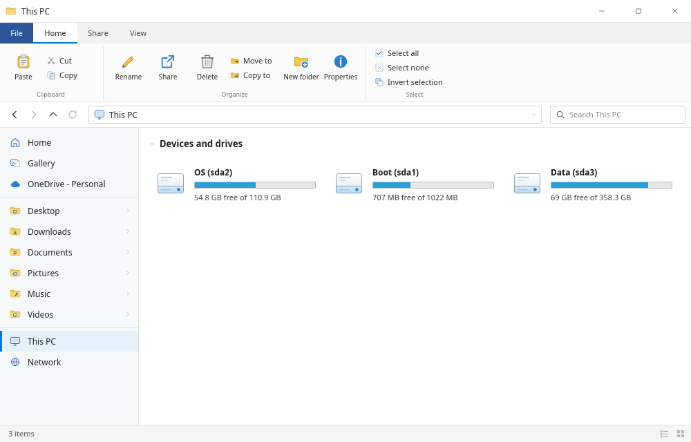

# Folder Lab

A Windows 10 style **This PC** home screen for Linux, written in Rust with [Slint](https://slint.dev).

It shows your real mounted partitions as drive cards (name, device, free space and a usage bar), inside a familiar Explorer-like window: tabs, ribbon, address bar, navigation pane and status bar.

> **Status: early prototype.** Only the main screen exists. The ribbon, address bar, sidebar and search box are visual only and do nothing yet (only File → Settings works). There is no folder browsing.

<!-- Add a screenshot here:  -->

## Features

- Lists real partitions only (ext4, btrfs, xfs, vfat, exfat, ntfs, f2fs, ...); loop and zram devices are ignored.
- One card per device, even when a btrfs disk is mounted in several places (`/`, `/home`, `/var`, ...).
- Drive names come from the filesystem label or partition label, with a fallback to the mount point (`OS`, `Boot`, `Home`, ...).
- Free / total space read with `statvfs`; the usage bar turns red above 90% used.
- Native window frame from your desktop environment (GNOME, KDE Plasma, ...), resizable.
- **File → Settings** opens a settings window with a **Theme** option: *Light*, *Dark* or *Follow system* (follows the desktop light/dark setting live). The choice applies immediately and is remembered between runs.
- Settings are stored in `~/.config/folder-lab/settings.conf` (a plain `key = value` file; `$XDG_CONFIG_HOME` is respected). A missing or broken file just falls back to the defaults.
- Small release binary (`opt-level = "s"`, LTO, stripped).

## Build and run

Requirements: a recent stable Rust toolchain and the usual windowing libraries for your distro (X11 or Wayland, fontconfig, a "Noto Sans" font recommended).

```sh
git clone https://github.com/<your-user>/folder-lab.git
cd folder-lab
cargo run --release
```

The project pins Slint `1.18.1` and uses the `femtovg` and `software` renderers on the `winit` backend. `async-executor 1.14.0` is vendored in `vendor/` and applied through `[patch.crates-io]`, because that version is marked yanked on crates.io.

## Project layout

```
src/main.rs          partition detection and the window setup
src/config.rs        loading/saving settings (~/.config/folder-lab/)
build.rs             compiles ui/app.slint
ui/
  app.slint          the window; assembles the sections
  settings-window.slint  the Settings window (theme choice)
  theme.slint        Theme global: all colors, light/dark/system
  types.slint        DiskInfo struct shared with Rust
  components/        small reusable pieces (Glyph, UsageBar, DriveCard, ...)
  sections/          parts of the screen (tabs, ribbon, address bar, nav pane, content, status bar)
  icons/             SVG icons
```

## Roadmap

- [ ] Open a drive and browse folders
- [ ] Working navigation (back / forward / up) and address bar
- [ ] Ribbon actions (copy, cut, paste, rename, delete, new folder, ...)
- [ ] Working sidebar shortcuts (Desktop, Downloads, Documents, ...)
- [ ] Search
- [x] Dark theme (File → Settings → Theme)
- [x] Remember the theme choice between runs

## License

MIT
